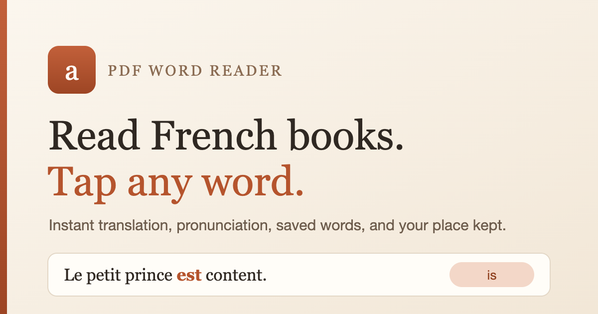

# PDF Word Reader

Read French PDF books in the browser. Tap any word to see its translation and hear it, select a phrase to translate the whole phrase, and pick up exactly where you stopped.

**Live app: [kunwarsagar54.github.io/pdf-word-reader](https://kunwarsagar54.github.io/pdf-word-reader/)**

[](https://kunwarsagar54.github.io/pdf-word-reader/)

## What it does

- **Tap a word** for a translation, other likely meanings, and pronunciation.
- **Select a phrase** to translate the whole phrase.
- **Picks the right meaning from context.** Google's one-word result for `est` is "East", but its dictionary ranks "is" far higher. The app reads the sentence around the word and the dictionary ranking, so `Le petit prince est content.` gives **is**, `Il voyage à l'est.` gives **east**, and `L'est de la France est beau.` gives **east** for the noun but **is** for the following verb.
- **Saved words** with export and clear, per profile.
- **My books** keeps your PDFs, page position, and last-opened time on the device.
- **Text size slider**, light and dark themes, drag and drop a PDF anywhere.
- **Profiles** — a guest library, local profiles, and optional Google sign-in, each with its own books and saved words.
- **Works offline-ish**: the page itself is static, and PDF parsing and the natural voice run locally. Translation (and the Google voice) need a network.

## Privacy

- PDFs are parsed in the browser with PDF.js and stored in IndexedDB. **The PDF file is never uploaded.**
- Only the word or phrase you tap is sent to the translation service that handles it.
- Saved words, books, and positions live in that browser's IndexedDB. They are **per device**, not synced, and not encrypted.
- Google sign-in is optional. It only reads the name, email, and picture from the ID token, locally. There is no app server and no token verification. It is a convenience profile switch, **not a security boundary** — anyone with access to the browser can switch profiles.

## Translation sources, in order

1. **Google Translate** (`clients5.google.com`, then `translate.googleapis.com`) — tried first because it is fast and returns the dictionary senses needed for context.
2. **Browser Translator API** — on-device, when the browser supports it. The availability check is cached per language pair.
3. **Claude artifact runtime** — only when the page is embedded in a compatible artifact runtime.
4. **MyMemory** — last resort.

## Pronunciation

Pick a voice in the **Voice** menu:

- **Natural** (default) — a Piper neural voice that runs entirely in the browser with ONNX Runtime. The first time you tap a word, the app asks before downloading the voice (about 100 MB, one time only, then cached on the device). It sounds natural, keeps working offline after the download, and the text never leaves the device. French, English, Spanish, German, Italian and Portuguese are supported.
- **Google (fast)** — Google's recorded voice, instant with nothing to download.

While the natural voice is downloading, taps keep working with the Google voice. If the natural voice cannot start (old browser, low memory, or blocked storage), the app falls back to Google and then to the device's Web Speech API voices, preferring any Enhanced, Premium or Siri voice installed on the device.

## If you hear no sound on iPhone

- Turn the **volume** up with the side buttons.
- On older Safari versions the **Silent switch** on the side of the phone mutes page audio. The app asks Safari to treat speech as playback audio, which keeps it audible on iOS 16.4 and newer.

## Run it locally

It is a static file. Open `index.html` directly, or serve the folder:

```sh
cd pdf-word-reader
python3 -m http.server 8000
```

Then open <http://127.0.0.1:8000>.

## Deploy

The app is hosted on GitHub Pages from the `main` branch root. To publish an update:

```sh
git add .
git commit -m "Update app"
git push
```

Pages redeploys in about a minute.

## Google sign-in setup (optional)

1. Create an OAuth 2.0 Client ID of type **Web application** in Google Cloud Console.
2. Add the site origin as an **Authorized JavaScript origin**:
   - `https://kunwarsagar54.github.io`
   - `http://127.0.0.1:8000` for local testing
3. Open the account dialog in the app and paste the Client ID. It is stored in that browser's local storage.

## Files

| File | Purpose |
| --- | --- |
| `index.html` | The entire app: HTML, CSS, and JavaScript in one file. |
| `site.webmanifest` | Installable web app metadata. |
| `icon-192.png`, `icon-512.png`, `apple-touch-icon.png` | Home screen and browser icons. |
| `og-image.png` | Social preview image. |

## Built with

Plain HTML, CSS, and JavaScript. No build step, no framework, no server. [PDF.js](https://mozilla.github.io/pdf.js/) 3.11.174 from cdnjs parses the PDFs.
